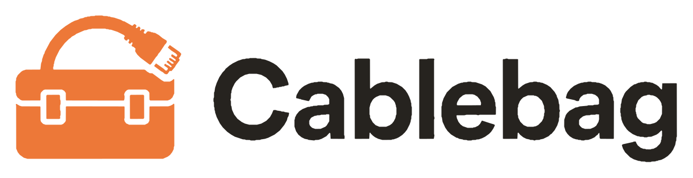
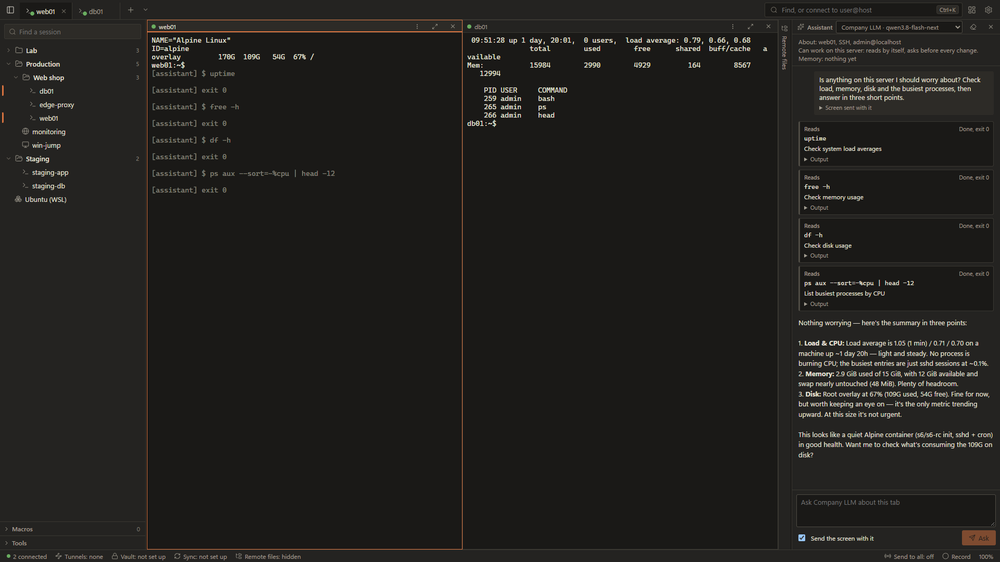
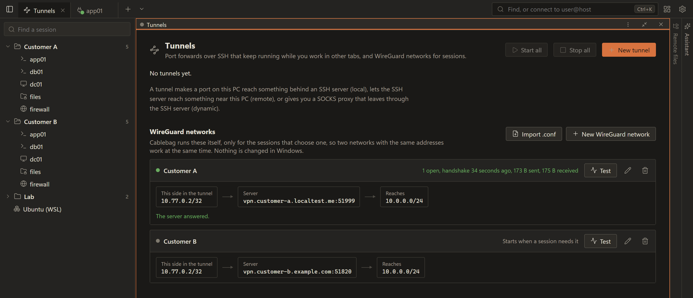
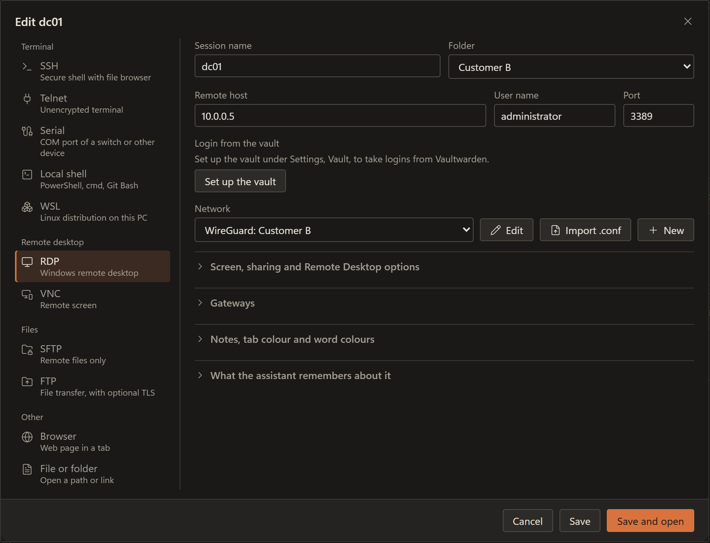

# cablebag: Multi-Protocol Remote Access Tabs with Per-Session WireGuard for Windows 10 & 11

    

---

Cablebag is a Windows remote access tool that puts SSH, RDP, VNC, Telnet, serial connections, SFTP/FTP, local shells, WSL, web pages and Proxmox consoles into tabs in a single window, with remote files beside every SSH tab, a password vault, session sync and an optional assistant. It is built for system administrators, IT consultants, MSP staff and homelab users who manage many machines and customer networks at once. What sets it apart is its built-in per-session WireGuard: instead of connecting the whole PC, it runs each VPN inside the app only for the sessions, folders or Proxmox servers that select it, so two networks with identical address ranges can be open side by side without interfering. It can import existing sessions from MobaXterm, PuTTY, KiTTY, WinSCP, the OpenSSH config and .rdp files.

## Features

- **One window, every protocol.** SSH, RDP, VNC, Telnet, serial ports, SFTP/FTP, local shells and WSL, and web pages all open as tabs — no separate clients to juggle.

- **WireGuard per session.** Cablebag runs WireGuard inside the app (userspace, no adapter and no routes), only for the sessions, folders or Proxmox servers that pick a network. Two VPNs whose machines share the same address ranges stay open side by side, in separate tabs.

- **Per-session and per-folder network choice.** Set the network in a folder's editor and its sessions inherit it; an individual session or subfolder can still go direct. A Tunnels overview shows live state: open connections, last handshake, traffic.

- **Keys stay encrypted.** Import an existing `.conf` or let Cablebag generate its own key pair (add its public key as an extra peer). Private keys live in the encrypted vault or come from a password-vault item; networks sync, keys do not.

- **SSH with the extras.** Remote files beside the terminal, local/remote/SOCKS port forwards, jump hosts, optional agent forwarding, and automatic reconnect in the same terminal.

- **RDP, VNC, Telnet, serial.** Remote Desktop sized to its pane with working Ctrl+Alt+Del; VNC, Telnet and serial ports as first-class tabs.

- **Files beside every SSH tab.** Browse the remote side and drag files in from Explorer. Edit text files over SFTP with line numbers, a before-you-write diff (red removed, green added), an automatic `name.bak`, and refusal to overwrite a file that changed since you opened it. Larger or binary files open in a Windows program and upload on save.

- **Proxmox as a live folder.** VMs and containers show state and addresses; double-click opens RDP, SSH or the console. Start, shut down, reboot, take/roll back/delete snapshots, and read recent tasks. A node shell over SSH, and everything routed through the chosen WireGuard network when one is set.

- **Tabs, split view and tiling.** Split the window for terminals, or tile every open tab and resize, swap, zoom and focus panes from the keyboard.

- **Search box.** Open any session, tab, Proxmox machine, tool, macro or setting by typing a few letters; `user@host` connects immediately; `>` lists commands.

- **Run on many servers.** One command across every SSH session in a folder, a few at a time, with answers side by side.

- **Workspaces and tab restore.** Save the open tabs under a name and reopen them from Home, or let Cablebag restore what was open at close.

- **Vault and passwords.** Logins from a password-vault server unlocked with Windows Hello; on-PC passwords encrypted under your Windows account and never synced or shown to the assistant. Built-in SSH key generator that installs the key on the server in one step.

- **Sync.** Sessions, folders, folder settings, macros, tunnels, WireGuard networks, workspaces and assistant memory sync through your own private encrypted git repository. Conflicts are named in Settings, Sync, with whose version was kept.

- **Assistant (optional).** Works with any OpenAI-API host you configure — nothing is sent until you add one. It can read the terminal or a screenshot, investigate read-only over SSH or inside a Proxmox guest, and propose changes as cards showing the command, reason, undo path and risk class; dangerous changes always get a red card. Secrets are stripped before text leaves the machine.

- **Tools.** Step-by-step SSH tunnel diagrams, a network and port scanner, Wake on LAN, and keyboard-shortcut macros.

- **Import.** MobaXterm, PuTTY, KiTTY, WinSCP, the OpenSSH config and `.rdp` files, each into its own folder; re-importing updates instead of duplicating.

- **No admin rights, no network changes.** Installer, app and in-app WireGuard all run under your own Windows account.

**Keyboard shortcuts**

| Keys | Action |
| --- | --- |
| Ctrl+K | Search box (inside a terminal: Ctrl+Shift+K) |
| Ctrl+Shift+T | New local terminal |
| Ctrl+Shift+N | New session |
| Ctrl+Shift+W | Close tab |
| Ctrl+Shift+D | Reopen the same session in a new tab |
| Ctrl+Shift+H | Home |
| Ctrl+Tab / Ctrl+Shift+Tab | Next / previous tab |
| Ctrl+Shift+E | Show or hide remote files |
| Ctrl+Shift+A | Show or hide the assistant |
| Ctrl+Alt+arrows | Tiling: focus the pane that direction (Shift: move it there) |
| Ctrl+Alt+Enter | Tiling: fill the area, or back |
| Ctrl+Shift+C / Ctrl+Shift+V | Copy / paste in the terminal |
| Ctrl+Shift+F | Find in the terminal |
| Ctrl+, | Settings |

## How it works

Cablebag is a Python application that wraps every supported protocol in a common tab model. A session is described by a small record: protocol, host, port, credentials source, folder, jump hosts, tab colour and an optional WireGuard network. The same record drives every view, so a tab looks the same whether it is an SSH terminal, an RDP pane, a file browser or a Proxmox console.

**Connection pipeline**

When a tab opens, the session record passes through the same stages regardless of protocol:

1. **Resolve settings.** The session inherits values from its folder (user name, key file, vault login, jump hosts, WireGuard network) and overrides only what it defines itself.
2. **Pick a network.** If the session, its folder or its Proxmox server selects a WireGuard network, the connection is bound to that network's internal stack. Otherwise it goes directly.
3. **Open a transport.** The protocol handler dials through the chosen transport — a socket inside the userspace stack for tunnelled sessions, or the normal system route for direct ones.
4. **Attach a view.** The transport is handed to the tab's view: terminal emulator, remote desktop surface, file browser or web view.
5. **Persist state.** The tab registers with the workspace so it can be restored, synced or reopened.

**WireGuard per session**

WireGuard is implemented in userspace (boringtun plus a small TCP/IP stack), so it does not touch the Windows network configuration:

| Concern | How Cablebag handles it |
|---|---|
| Two VPNs with identical ranges | Each network is a separate address space inside the app; tabs are bound to one network and never see another |
| No adapter, no routes | Tunnels exist only as objects in the process; nothing else on the PC is affected |
| Web pages | Each tab gets a private internal proxy bound to its network, with its own cookie jar |
| Proxmox | API calls, consoles, node shells and machine sessions all use the network configured for that server |
| Keys | Private keys live in the encrypted vault or come from a Vaultwarden item; only non-secret network metadata travels with Sync |

The Tunnels page tracks live state per network — open connections, last handshake and byte counters — by reading counters from the tunnel object rather than from the OS.

**Terminal sessions**

SSH, Telnet, serial and local shells share one terminal widget. The protocol layer feeds bytes into it and receives keystrokes back, so search, copy/paste, split view, tiling and reconnect behave identically across protocols. Port forwards and jump hosts are additional hops applied to the transport before the terminal attaches. When a connection drops, the terminal is kept and reattached once the transport reconnects.

**File sessions**

SFTP and FTP sessions reuse the same tab frame with a file browser instead of a terminal. The editor streams the file over the session, writes through a temporary copy and keeps the previous version as a backup; a file whose remote modification time changed since it was opened is refused rather than overwritten. Windows programs can be used instead: the file is downloaded, watched for changes, and uploaded again on save.

**Proxmox**

A Proxmox server is represented as a live folder. Its API client enumerates guests and their state, and each guest becomes a child entry whose double-click maps to RDP, SSH or the console depending on the guest. Snapshots and task logs are API calls rendered in their own views. The node shell and any sessions opened for guests inherit the server's network choice.

**Assistant**

The assistant column is inactive until an OpenAI-compatible host is configured. When used, it receives context assembled from the active tab (terminal tail or a screen capture), runs read-only investigation commands through the session's transport, and returns proposed changes as cards. Command classification, secret redaction and approval gating happen inside Cablebag before anything is displayed or executed.

**Sync**

Sync operates on the session, folder, macro, tunnel, network, workspace and assistant-memory records. Records are encrypted client-side and committed to a private repository; secrets are stripped before that step. Conflicts are detected per record by comparing changes since the last common version, and the losing version is reported rather than silently discarded.

## Configuration

Cablebag keeps its settings in a few places, depending on what is being configured: the app-wide settings window, the editor for each session or folder, and the pages for networks, Proxmox servers, sync and the assistant. Everything is stored locally under your Windows account; only what you explicitly enable (Sync, the assistant) ever leaves the PC.

## General settings

Open Settings from the Ctrl+, shortcut or the gear in the window. The pages are:

| Page | What it holds |
| --- | --- |
| General | Start-up behaviour, reopen tabs from last time, close confirmation, language |
| Appearance | Theme, tab colours, tiling defaults, terminal font and colours |
| Keyboard shortcuts | Every shortcut in the app, editable per action |
| Sessions | Defaults for new sessions (user name, key file, terminal size, reconnect) |
| Files | Editor behaviour, backup suffix, external editor per file type |
| Proxmox | Servers, API tokens, default network per server |
| Tunnels | WireGuard networks and their live state |
| Sync | Git repository, encryption passphrase, conflict handling |
| Assistant | AI hosts, approval policy, what may be sent, history |
| About Cablebag | Version, licence, backup and restore |

## Session and folder settings

A session's editor is where connection details live. A folder's editor sets values its sessions inherit; a session only overrides what it sets itself.

- **Connection:** host, port, protocol (SSH, RDP, VNC, Telnet, serial, SFTP/FTP, local shell, WSL), user name.
- **Authentication:** password from the vault, key file, SSH agent (Pageant or the Windows OpenSSH agent, off by default), or a login stored in Vaultwarden.
- **Network:** Direct, or a WireGuard network defined under Tunnels. Inherited from the folder unless set.
- **Terminal / display:** size, font, colours, RDP resolution and pane sizing.
- **Files:** whether the remote files pane opens on connect, and the starting directory.
- **Advanced:** jump hosts, port forwards (local, remote, SOCKS), keepalive, automatic reconnect.

Folder settings additionally cover tab colour, jump hosts shared by the folder, a default vault login, the WireGuard network, and whether the folder is protected (the assistant must ask before every change).

## WireGuard networks

Each network is created under Tunnels, either by importing an existing `.conf` or by generating a key pair inside Cablebag.

- **Import .conf:** reads Address, PrivateKey, DNS and Peer blocks; the private key goes into the encrypted vault.
- **New:** generates a key pair; add the displayed public key to the server as a peer.
- **Edit:** endpoints, allowed IPs, keepalive, DNS.
- **Keys from Vaultwarden:** a network can reference a private key stored there instead of the local vault.

Two networks may use identical address ranges; they stay isolated because each only applies to the sessions, folders or Proxmox servers that select it.

## Proxmox servers

Add a server under Settings, Proxmox:

- **Host and port** of the API endpoint.
- **API token** (token ID and secret), stored in the vault.
- **Network:** Direct or a WireGuard network, applied to the API, consoles, node shell and the sessions Cablebag opens for guests.
- **Permissions:** snapshots need `VM.Snapshot` and `VM.Snapshot.Rollback`; the in-guest assistant needs `VM.GuestAgent.Unrestricted`.

## Sync

Sync uses a private git repository you provide. Configure it under Settings, Sync:

- **Repository and branch**, plus credentials if the remote needs them.
- **Encryption passphrase** for the synced data; it is never stored in the repository.
- **What syncs:** sessions, folders and folder settings, macros, tunnels, WireGuard networks, workspaces and the assistant's memory. Passwords and private keys are excluded.
- **Conflicts:** when the same item changed on two PCs, the page names the conflict and shows which version was kept.

## Assistant

Nothing is sent anywhere until you add a host under Settings, Assistant:

- **Host:** base URL and model name for any endpoint speaking the OpenAI API.
- **Approval policy:** ask before every change, or only before dangerous ones. Protected folders always ask.
- **Remote desktop control:** whether clicking, scrolling and typing are allowed, per action or per screen.
- **Memory:** view, edit and undo what the assistant has learned per server, per folder and in general.
- **History:** everything that was sent and what came back.

## Backup and restore

From About Cablebag, export all local data to a single file and restore it later. Vault passwords are included only if you choose to include them; synced items can be restored from the repository instead.

## 📸 Screenshot

## Requirements

- **Windows 10 or Windows 11** on x64. No other operating systems are supported.
- **The .NET 8 Desktop Runtime** is needed for Remote Desktop tabs. Without it, SSH, VNC, Telnet, serial, SFTP/FTP, WSL and Proxmox sessions still work.
- **No administrator rights** are needed to install or to run Cablebag, including its built-in WireGuard sessions.
- **No changes to Windows network settings.** No WireGuard adapter is created and no routes are added.

The table below lists what each connection type needs on the machine Cablebag talks to, not on the PC running it.

| Session type | What the target needs |
| --- | --- |
| SSH, SFTP | An SSH server reachable on the chosen host and port |
| RDP | A Remote Desktop host; the .NET 8 Desktop Runtime on the Cablebag PC |
| VNC | A VNC server and its port |
| Telnet | A Telnet service on the target |
| Serial | A serial port visible to Windows on the Cablebag PC |
| FTP | An FTP server reachable on the chosen host and port |
| WSL | A WSL distribution registered under the same Windows account |
| Proxmox | A Proxmox API token; snapshots need `VM.Snapshot` and `VM.Snapshot.Rollback`; the assistant inside a VM needs `VM.GuestAgent.Unrestricted` on Proxmox 9 |
| Web pages | A reachable HTTP or HTTPS address |

Optional components have their own conditions:

- **WireGuard per session** works entirely inside Cablebag. Existing `.conf` files can be imported, or Cablebag can generate its own key pair. None of this requires the WireGuard app or a Windows adapter.
- **Vaultwarden logins** need a Vaultwarden account reachable from the PC and Windows Hello for unlocking.
- **Sync** needs an empty private git repository of your own; sessions, folders, tunnels, networks and workspaces sync encrypted, while passwords and private keys stay out.
- **The assistant** needs an AI host that speaks the OpenAI API, such as LiteLLM, vLLM, Ollama or a cloud service. Without a configured host it does nothing.
- **Automatic updates** come only from the official release page and are installed only when signed by Cablebag.

## FAQ

**Is cablebag free to use?** Yes, for private and work use, on as many machines as you like. It is free but not open source; see the licence section.

**Does it need administrator rights?** No. Installation, the app itself and the embedded WireGuard all run under your own Windows account.

**Does it change my network configuration?** No. WireGuard runs inside cablebag and only for the sessions, folders or Proxmox servers that select a network. No adapter is created, no system route is added, and other applications on the machine are unaffected.

**Can two VPNs with the same address range be open at once?** Yes. Each WireGuard network is its own isolated network inside cablebag, so overlapping ranges do not collide. A tab left open for one customer keeps talking to that customer's addresses.

**Can I reuse my existing WireGuard configuration?** Yes — import the `.conf`. Use it either in cablebag or in the WireGuard app, not both at the same time. Alternatively, let cablebag generate its own key pair and register its public key on the server as an additional peer, so both tunnels remain usable.

**Which session types can go through a WireGuard network?**

| Session type | Through the tunnel |
| --- | --- |
| SSH / SFTP | Yes |
| RDP | Yes |
| VNC | Yes |
| Telnet | Yes |
| Web pages in a tab | Yes (dedicated internal proxy per tab) |
| Proxmox API, consoles, node shell | Yes (when a network is set for that server) |
| Local shells and WSL | No, they are local |

**How do I set a network for many sessions at once?** Set it on a folder; its sessions and subfolders inherit it. An individual session or subfolder can still be switched back to a direct connection.

**Where are private keys stored?** In cablebag's encrypted vault, or supplied from a Vaultwarden item. Private keys are never part of Sync; only the network definitions travel.

**Can I import my existing sessions?** Yes — from MobaXterm (`MobaXterm.ini` or `.mxtsessions`), PuTTY and KiTTY saved sessions, WinSCP sites, an OpenSSH config and `.rdp` files. Each source gets its own folder, and importing again updates existing entries instead of duplicating them.

**Where are my passwords kept?** Either in Vaultwarden, unlocked with Windows Hello, or encrypted on this PC under your Windows account. They are never included in Sync and are never shown to the assistant.

**Does it work on Linux or macOS?** No — Windows 10 and 11 only.

**What does Remote Desktop support require?** The .NET 8 Desktop Runtime.

**Where does the assistant send my data?** Only to the AI host you configure yourself (any endpoint speaking the OpenAI API), and only after secrets — passwords, keys, tokens, password hashes — are removed. With no host configured it does nothing.

**Can the assistant change things without asking?** No. Every change is shown as a card with the command, the reason and how to undo it. cablebag classifies the command itself, and dangerous operations always require confirmation. You can require confirmation for all changes or only for dangerous ones; protected folders always ask.

**What happens when a connection drops?** SSH sessions reconnect automatically in the same terminal.

**Can I keep my open tabs between runs?** Yes — save them as a named workspace, or let cablebag reopen what was open when it closed.

## Disclaimer

Cablebag is a remote access tool: it connects to servers, networking equipment, hypervisors and other machines with the credentials you give it, and it can run commands there, including through its optional assistant. Treat every session as if you were typing on that machine yourself.

- **You are responsible for what runs.** Commands issued through Cablebag — by you, by a macro, by Run on many servers, or by the assistant after you approve a card — execute on the remote system with the rights of the login used. Cablebag classifies commands and can require confirmation, but that classification is a safety aid, not a guarantee.
- **Only connect to systems you are allowed to access.** Using Cablebag against machines without the owner's permission may be illegal in your jurisdiction. Access to customer networks, Proxmox hosts and network devices should follow the agreements you have with their owners.
- **Credentials and keys stay your responsibility.** Passwords kept on the PC are encrypted under your Windows account, Vaultwarden items and WireGuard private keys are read only when needed, and Sync leaves secrets out — but the security of the Windows account, the vault server and the sync repository is yours to maintain. Back up your data before relying on it.
- **WireGuard networks are isolated inside Cablebag by design.** Nothing else on the PC is routed through them, so other applications on the same machine will not reach those networks — and conversely, sessions that do not choose a network go directly.
- **The assistant is optional and third-party.** It sends text and screenshots only to the AI host you configure, after secrets are filtered, and its output can be wrong. Review every proposed change. The assistant's answers are not advice you should follow blindly on production systems.
- **No warranty.** Cablebag is provided "as is", without warranty of any kind. The authors are not liable for data loss, downtime, security incidents, misconfiguration or any other damage arising from its use. Test in a safe environment before using it on systems that matter.
- **Third-party components** included in Cablebag remain under their own licences and terms; their notices are shipped with the app.
- **Not affiliated.** Cablebag is an independent project and is not endorsed by, affiliated with, or supported by any of the protocols, products or services it can connect to or integrate with. Names are used only to describe compatibility.

